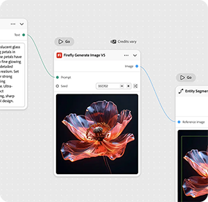
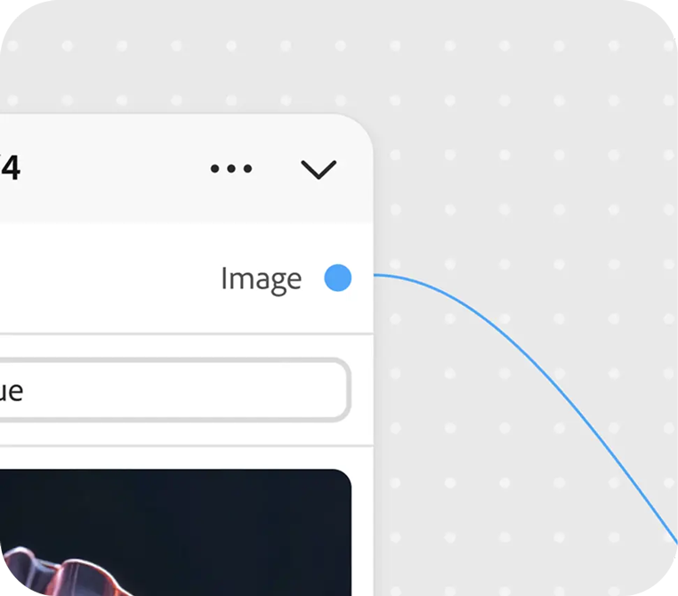
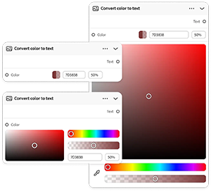
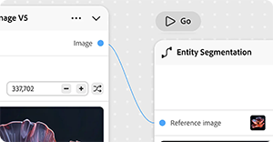

# &#x200B;2. Conceptos clave de Firefly Graph

Descubre los conceptos clave que te ayudarán a empezar a usar Firefly Graph.

## Nodo

Un nodo realiza un paso en el flujo de trabajo: un nodo, un trabajo. Un nodo puede generar una imagen, aplicar una máscara, cambiar un color o ejecutar cualquier otra acción creativa.

{align="center"}

## Puerto

Los puntos de conexión de un nodo. Los puertos de salida pasan datos fuera de un nodo; los puertos de entrada reciben los datos que entran. Conectar puertos es la forma en que fluyen los datos a través del flujo de trabajo.

{align="center"}

## Widget

Controles interactivos en un nodo, como campos de texto, menús desplegables y controles deslizantes, que le permiten configurar sus opciones directamente en el editor.

{align="center"}

## Conexión

Una conexión lleva una entrada o salida entre dos nodos. Un gráfico se lee de izquierda a derecha, desde la entrada de origen hasta la salida final.

{align="center"}

## Gráfico

El flujo de trabajo completo que se genera en el editor. Un gráfico se compone de nodos y conexiones dispuestos en el lienzo para producir un resultado final.

{align="center"}

## Siguiente paso

¿Listo para construir algo? Pasar a [3. Crea tu primer gráfico](https://experienceleague.adobe.com/en/docs/creative-cloud-enterprise-learn/cce-learning-hub/fireflyoverview/firefly-graph/create-your-first-graph) para ver un tutorial paso a paso.

Vuelva a [Introducción a Firefly Graph](https://experienceleague.adobe.com/en/docs/creative-cloud-enterprise-learn/cce-learning-hub/fireflyoverview/firefly-graph/overview-firefly-graph).
