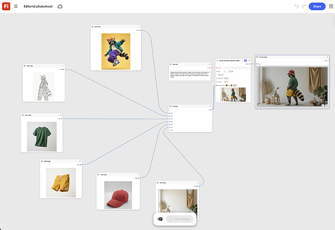

# Sesión de fotos editorial

Aprende a introducir una referencia de modelo e intercambiar la entrada de prenda para cada nuevo aspecto. Los nodos de pose e iluminación permanecen bloqueados en todo el conjunto para una sensación editorial coherente. [Abrir plantilla de fotografía editorial](https://firefly.adobe.com/graph/edit/id/urn:aaid:sc:US:cfd7b810-2f86-5cdf-af80-dd2e31b8b84b).

[!BADGE Ejemplos del sector]{type=Informative tooltip="Ejemplos del sector"}

* **Comercio al por menor**: intercambia prendas de un modelo en una sesión editorial completa por un catálogo de temporada, sin tener que volver a reservar el modelo para cada aspecto individual.
* **Belleza**: crea una serie editorial coherente en varios aspectos del producto utilizando una referencia de modelo.
* **Al aire libre**: genera un conjunto editorial completo a través de una nueva alineación de colores de chaqueta a partir de una sola toma de modelo.

>[!TIP]
>
>**Antes de comenzar**: para obtener los mejores resultados, personaliza esta plantilla para adaptarla a tu propia marca, producto y flujo de trabajo. Intercambie las imágenes de referencia, los mensajes y la copia antes de utilizar cualquier salida.

{align="center"}

Vuelva a [Introducción a Firefly Graph](https://experienceleague.adobe.com/es/docs/creative-cloud-enterprise-learn/cce-learning-hub/fireflyoverview/firefly-graph/overview-firefly-graph).
