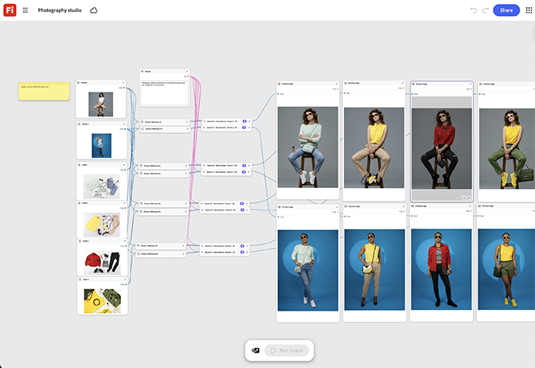

# Estudio fotográfico

Aprende a colocar el renderizado de un producto en el nodo de fondo del estudio y a ajustar los nodos de la plataforma de iluminación hasta que el resultado se vea como una captura de estudio real. [Abrir plantilla de estudio fotográfico](https://firefly.adobe.com/graph/edit/id/urn:aaid:sc:US:63ad7c3b-2cb3-5474-ba8c-7e1c8d8a570f).

[!BADGE Ejemplos del sector]{type=Informative tooltip="Ejemplos del sector"}

* **Bebidas**: genera fotos limpias de productos de estudio de un nuevo SKU de sabor antes de la fotografía física de productos que se está programando.
* **Tecnología**: crea renderizaciones con calidad de estudio de un nuevo dispositivo para una página de inicio antes de que las unidades estén disponibles para fotografiar.
* **Retail**: haz fotos de estudio uniformes en toda la línea de productos sin reservar sesiones de fotografía individuales.

>[!TIP]
>
>**Antes de comenzar**: para obtener los mejores resultados, personaliza esta plantilla para adaptarla a tu propia marca, producto y flujo de trabajo. Intercambie las imágenes de referencia, los mensajes y la copia antes de utilizar cualquier salida.

{align="center"}

Vuelva a [Introducción a Firefly Graph](https://experienceleague.adobe.com/es/docs/creative-cloud-enterprise-learn/cce-learning-hub/fireflyoverview/firefly-graph/overview-firefly-graph).
